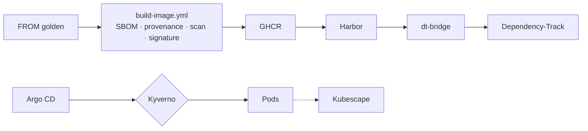

# harbor-lab

> 📖 **Documentation complète** (architecture, modèle de menace, décisions, ce qui a cassé, limites) :
> 🇫🇷 <https://naqa92-portfolio-projects.github.io/harbor-docs/> · 🇬🇧 <https://naqa92-portfolio-projects.github.io/harbor-docs/en/>

Plateforme de gouvernance des images de conteneurs sur un cluster kind unique. Une application n'écrit que
`FROM <image golden>` et une ligne `uses:` vers le workflow de build ; la plateforme s'occupe du reste :
build, SBOM, provenance SLSA, signature keyless, réplication dans Harbor, admission Kyverno par niveau de
confiance, détection runtime Kubescape et tri des CVE dans Dependency-Track.



Le catalogue des images golden est généré dans [docs/golden-images.md](docs/golden-images.md).

## Prérequis

| Prérequis | Vérification |
|---|---|
| [devbox](https://www.jetify.com/devbox) installé : il épingle toutes les CLI (kind, kubectl, Helm, cosign, OpenTofu, Kyverno, Task…) | `command -v devbox` |
| Démon Docker démarré (kind fait tourner le cluster dans un conteneur Docker) | `docker info >/dev/null 2>&1` |
| GitHub CLI (`gh`) connecté | `gh auth status` |
| Dépôt public : identité de signature keyless, images GHCR publiques, OpenSSF Scorecard | `gh repo view --json visibility -q .visibility` |
| Un ruleset sur `main` qui bloque la suppression et les force-push (`non_fast_forward`), rien d'autre. Réglage manuel dans les paramètres du dépôt, non automatisé | `gh api repos/{owner}/{repo}/rulesets` |
| Un jeton de compte Docker pour `dhi.io` dans le `.env` ignoré par Git (`DHI_TOKEN`), avec le nom du compte (`DHI_USERNAME`) | `grep -q '^DHI_TOKEN=.' .env && grep -q '^DHI_USERNAME=.' .env` |
| Les mêmes `DHI_TOKEN` et `DHI_USERNAME` en secrets GitHub Actions (build des images golden) | `gh secret list` |
| Au moins 16 GiB de RAM disponibles pour Docker (WSL compris) | `free -g` |

Le ruleset empêche de réécrire ou de supprimer `main`, mais il ne restreint pas qui peut pousser : l'identité
de signature `build-image.yml@refs/heads/main` est donc liée à quiconque a le droit d'écriture sur le dépôt
(le seul propriétaire). Un autre dépôt qui appellerait `build-image.yml` comme workflow réutilisable est
bloqué séparément, par la garde `github.repository` du job.

`.env` n'est lu que par le Taskfile ; `task up` en recopie les valeurs dans OpenBao, d'où External Secrets
les livre au cluster. Ne jamais le commiter.

```sh
cat > .env <<'EOF'
DHI_USERNAME=<nom du compte docker>
DHI_TOKEN=<jeton docker avec le scope pull dhi.io>
EOF
chmod 600 .env
```

## Démarrer et arrêter

```sh
devbox run -- task up     # crée ou fait converger le cluster ; rend la main quand toutes les Applications Argo CD sont stables
devbox run -- task down   # supprime le cluster et son kubeconfig dédié
```

`task up` crée le cluster kind `harborlab` avec son propre kubeconfig, `.kube/harborlab.yaml`
(`export KUBECONFIG=$PWD/.kube/harborlab.yaml`). Argo CD déploie la plateforme depuis la branche
courante telle que poussée sur `origin` (`HARBORLAB_REVISION=<révision>` la remplace). Un démarrage complet
prend environ 15 minutes.

La plateforme ne survit pas à un nœud arrêté : après `docker stop harborlab-control-plane`, un redémarrage
de l'hôte ou de Docker, OpenBao revient scellé et certains contrôleurs ne reconvergent pas. Reprise :
reconstruire avec `devbox run -- task down && devbox run -- task up` (`task down && task up`) ; la CA locale
de `.local/ca/` est conservée, tous les autres secrets sont régénérés.

Interfaces web, sous la CA locale `.local/ca/ca.crt` (à importer dans le navigateur) :

| Service | URL | Identifiants |
|---|---|---|
| Harbor | `https://harbor.127.0.0.1.nip.io` | `admin`, mot de passe dans le Secret `harbor/harbor-admin` |
| Argo CD | `https://argocd.127.0.0.1.nip.io` | `admin`, mot de passe dans le Secret `argocd/argocd-initial-admin-secret` |
| Dependency-Track | `https://dependency-track.127.0.0.1.nip.io` | `admin`, mot de passe dans OpenBao `secret/platform/dependency-track-admin` |
| Grafana | `https://grafana.127.0.0.1.nip.io` | `admin`, mot de passe dans le Secret `observability/grafana-admin` |
| Policy Reporter | `https://policy-reporter.127.0.0.1.nip.io` | aucun |

## Tâches courantes

| Tâche | Rôle |
|---|---|
| `task harbor:configure` / `task harbor:plan` | Appliquer / planifier la configuration Harbor OpenTofu (`tofu/harbor`) |
| `task catalog:generate` / `task catalog:check` | Régénérer / vérifier les paramètres Kyverno et le catalogue depuis `images/catalog.yaml` |
| `task lint` | Le lint plateforme lancé par la CI sur chaque pull request |
| `task demo:<scénario>` | Un scénario de gouvernance, voir ci-dessous |
| `task release:repin` | Ré-épingler les références après un merge sur `main`, voir plus bas |

## Scénarios de démo

Chaque scénario sort en 0 quand la plateforme réagit comme prévu, en non-zéro sinon. Les sept scénarios
d'admission soumettent un pod dans le namespace `NAMESPACE` (par défaut `runtime-demo`) :
`devbox run -- task demo:unsigned NAMESPACE=<ns>`. Dans un namespace sans label `harborlab.io/tier`, tout
pod est refusé par `tier-required` et la tâche sort en 0.

| Scénario | Réaction attendue |
|---|---|
| `demo:unsigned` | refus par `workload-image-signature` |
| `demo:foreign-signer` | refus par `workload-image-signature` |
| `demo:non-golden-base` | refus par `workload-golden-base` |
| `demo:deprecated-base` | admis avec un avertissement `workload-golden-base-deprecated`, image réécrite en digest |
| `demo:eol-base` | refus par `workload-golden-base` |
| `demo:direct-dockerhub` | refus par `workload-registry` |
| `demo:root` | refus par Pod Security `restricted` |
| `demo:runtime-shell` | alerte Kubescape `R0001` dans VictoriaLogs |
| `demo:vex` | VEX accepté par Dependency-Track (`COMPLETED`) |

Ce que prouve chaque scénario : [page Démo](https://naqa92-portfolio-projects.github.io/harbor-docs/demo/).

## Après un merge

L'admission et `dt-bridge` ne font confiance qu'à `build-image.yml@refs/heads/main` : les images construites
sur une branche `prd-*` mergée ne sont plus reconnues. `release-repin.yml` ré-épingle, dans l'ordre des
dépendances, à chaque push sur `main` qui le nécessite, en ouvrant une pull request par étape (jamais de push
direct sur `main`) :

1. `dockerfiles` : les `FROM` des Dockerfiles applicatifs, une fois le catalogue mis à jour par `golden.yml`.
2. `workloads` : `platform/workloads/*/*.yaml`, une fois les images applicatives reconstruites.
3. `fixtures` : le commit de `images/demo-fixtures.yaml`, une fois les fixtures publiées.
4. `e2e-params` : les Dockerfiles de fixtures E2E et les paramètres Kyverno E2E (workflow `release-repin-e2e.yml`).

`devbox run -- task release:repin` lance les mêmes étapes à la main.

Les pull requests ouvertes avec le `GITHUB_TOKEN` du workflow ne déclenchent aucune CI `pull_request` ;
aucun check n'est obligatoire, elles peuvent donc être mergées sans, et le mainteneur peut relancer la CI sur
la branche.

## Budget mémoire

Avec tous les composants démarrés, le cluster reste sous **12 GiB**. La mesure de référence est le working set
du nœud kind, tel que le rapporte le pipeline de métriques :

```sh
export KUBECONFIG=$PWD/.kube/harborlab.yaml
kubectl top nodes
```

Le working set compte la mémoire résidente plus le page cache actif (couches d'images containerd, base Grype
de Kubescape, buffers PostgreSQL). Une plateforme neuve mesure environ 10,0 à 10,4 GiB ; le pic enregistré
est de 10 708 Mi. `docker stats harborlab-control-plane` peut différer ; `kubectl top nodes` fait foi.
